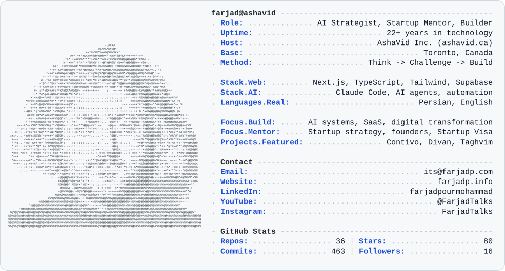

<a href="https://farjadp.info">
  <picture>
    <source media="(prefers-color-scheme: dark)" srcset="dark_mode.svg">
    
  </picture>
</a>

<!--
How this card works
  config.json                  the text on the card. Edit it, push, and the card redraws.
  today.py                     draws dark_mode.svg and light_mode.svg, adds live GitHub numbers.
  .github/workflows/update.yml runs today.py every day and after each push.
  scripts/make_ascii.py        rebuilds the ASCII portrait from a photo (needs: pip install pillow).
-->
